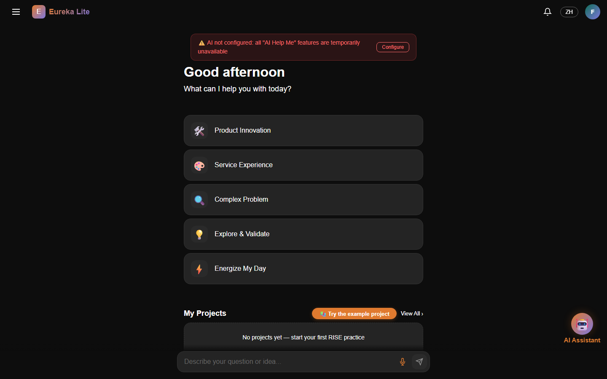
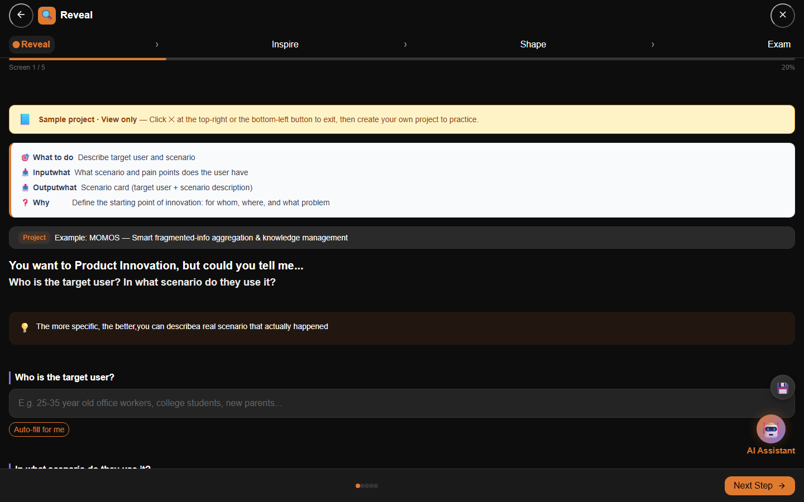
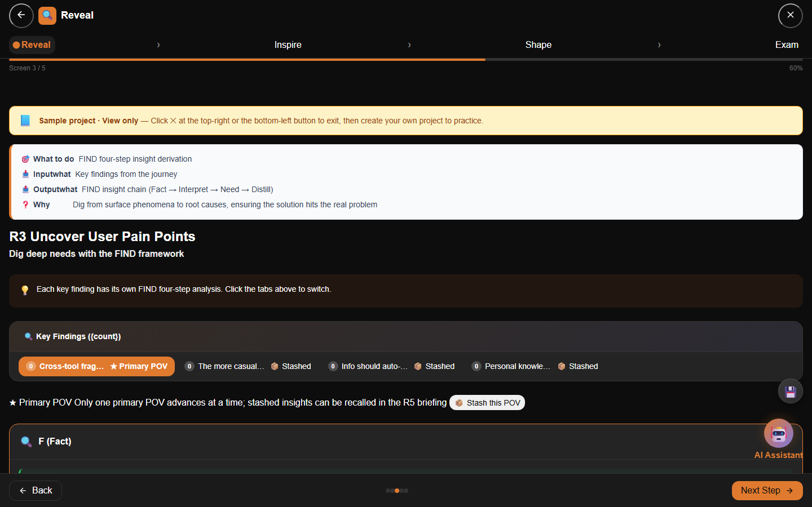
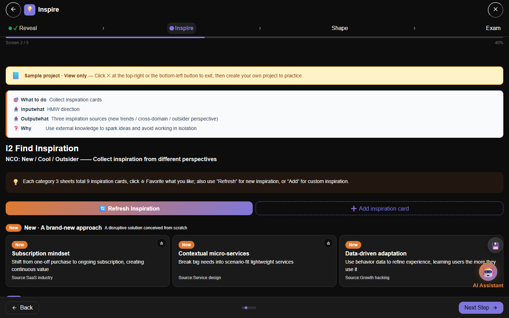
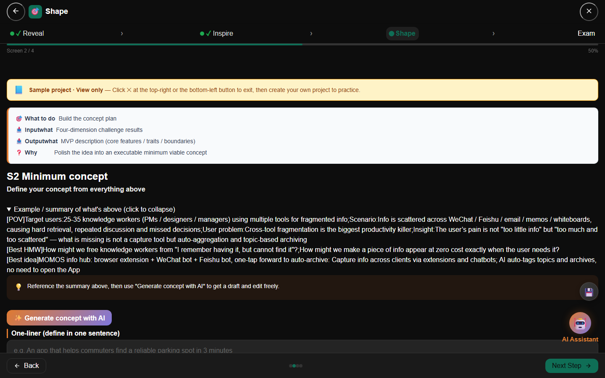
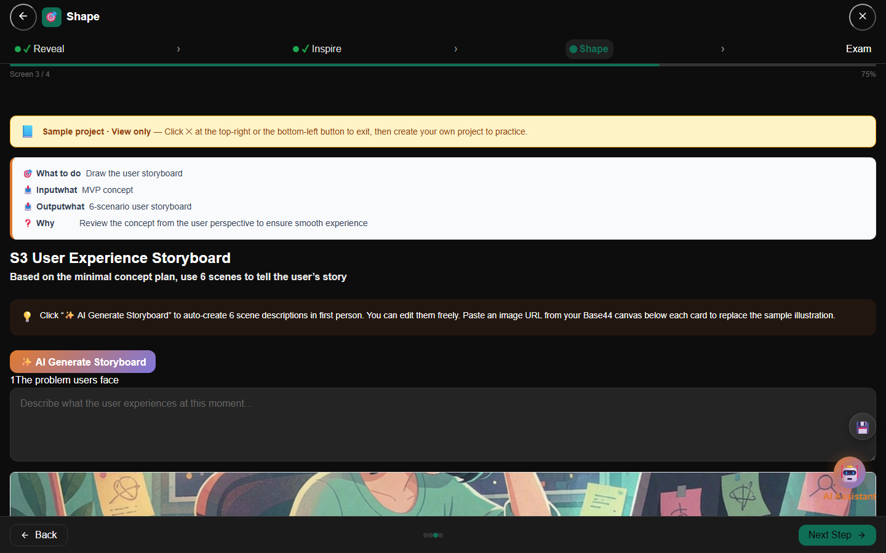
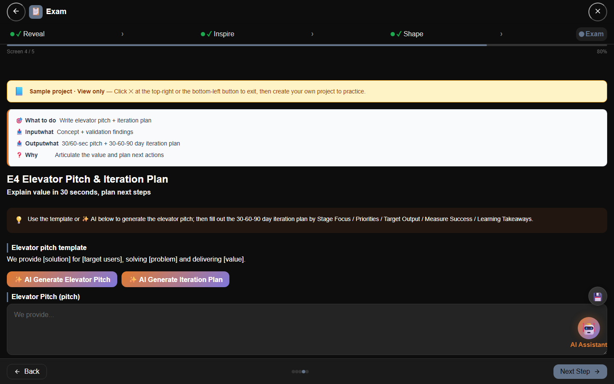
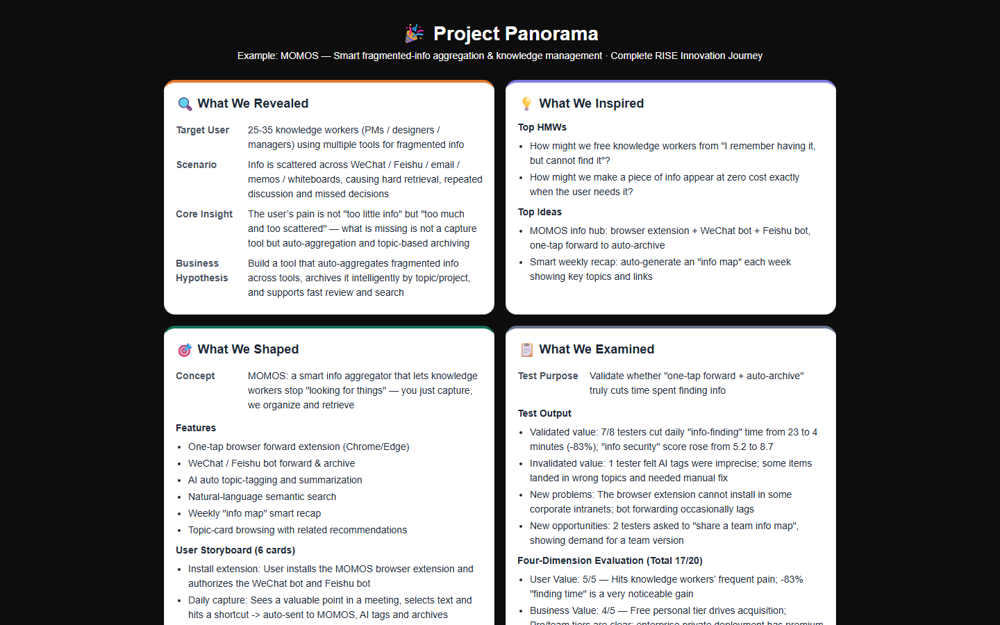

# Eureka Lite

> A lightweight, AI-assisted innovation workspace that turns raw observations into validated concepts — one RISE step at a time.

[](https://davidma1973simu.github.io/eureka-lite-en/)
[](./LICENSE)



## Key Screens

All screenshots below are real browser renders of the English build.

| | |
|---|---|
|  |  |
| **R1 · Scene & Scenario** | **R3 · FIND analysis with Primary / Stashed POVs** |
|  |  |
| **I2 · HMW reframing & idea generation** | **S2 · Minimal concept plan (MVP)** |
|  |  |
| **S3 · Six-scene user storyboard with sample art** | **E4 · Four-dimension evaluation & elevator pitch** |


**Project Panorama** — a one-page, four-quadrant summary of the whole RISE journey.

A marketing landing page is also included at [`landing.html`](landing.html) (persona stories + the full 19-task RISE walkthrough).

## What is Eureka Lite?

**Eureka Lite** is a browser-based innovation toolkit for teams, founders, designers, educators, and product managers who want a structured way to move from "we think we have an idea" to "we validated it" without drowning in templates.

It wraps the **RISE methodology** — a 4-stage innovation flow — into 19 focused screens, each with built-in guidance, examples, and an AI assistant that brainstorms, critiques, and researches alongside you.

No signup required. Your work is stored locally in your browser.

## The RISE Methodology

Every project walks through four stages, each building on the last.

| Stage | Focus | What you do |
|-------|-------|-------------|
| **Reveal** 🔍 | Discover the real problem | Innovation scenario, user journey map, pain-point analysis with the FIND framework, stakeholder needs, and a project brief. |
| **Inspire** 💡 | Reframe and generate ideas | POV statements, HMW questions, NCO inspiration cards, forced-connection ideation, and idea scoring. |
| **Shape** 🎯 | Turn ideas into testable concepts | Four-dimension interrogation, minimum concept, storyboard, and build summary. |
| **Exam** 📋 | Validate before you build | Test plan, test report, four-dimension evaluation, elevator pitch, and validation summary. |

At the end of each stage, a **Project Panorama** gives you a single-page view of everything you have created.

## Key Features

- **AI Assistant Panel** — Choose between *Help me brainstorm*, *Critique me*, and *Look it up* modes. Bring your own API key; prompts stay between you and your chosen model. A **🙋 Ask a human expert** shortcut is available in the quick actions.
- **FIND Framework** — Built into Reveal stage to move from facts → interpretation → needs → design opportunities. Every key finding carries its own FIND analysis; exactly one **Primary POV** advances at a time and stashed POVs can be recalled in the R5 briefing.
- **Real-AI Stakeholder Analysis** — Stakeholder groups and scored needs are generated by a real LLM call (with meaningful local fallback when no key is configured).
- **AI Storyboarding with Sample Art** — The Shape stage generates six first-person scene descriptions; sample illustrations ship out of the box and can be replaced with your own images.
- **NCO Inspiration Cards** — Cross-domain inspiration cards to break fixation and spark new angles.
- **Forced-Connection Ideation** — Generate unexpected combinations by linking your problem to distant domains.
- **Four-Dimension Scoring** — Evaluate ideas across user, business, technology, and ecosystem dimensions.
- **Project Panorama** — One-page summary of your entire innovation project, ready to share or export.
- **Example Project (MOMOS)** — A built-in four-stage walkthrough of MOMOS, a smart fragmented-info aggregation tool, so first-time users can see the full RISE flow immediately.
- **Multilingual** — Supports English and Chinese; the English build opens by default with a zero-Chinese guarantee in English mode (toasts, modals and stage briefings included).

## Who is it for?

- **Product teams** running early-stage discovery or design sprints.
- **Startup founders** who need to pressure-test an idea before writing code.
- **Educators** teaching design thinking, innovation, or entrepreneurship.
- **Consultants and facilitators** who want a reusable, portable workshop tool.

## Quick Start

1. Open the live demo: **[https://davidma1973simu.github.io/eureka-lite-en/](https://davidma1973simu.github.io/eureka-lite-en/)**
2. Click **Try Example Project** to explore the full RISE flow with a real sample.
3. Start a new project, pick a category, and follow the guided screens.
4. Open the **AI Assistant** panel when you want suggestions, critiques, or research help.

## AI Setup (Optional)

Eureka Lite works out of the box, but the AI features become more powerful when you add your own model key:

1. Click the **AI Assistant** ⚙️ settings button.
2. Choose your provider (e.g., OpenAI).
3. Paste your API key.
4. Select a model and save.

Your key is stored in your browser's `localStorage` and is only used to call the provider you selected.

## Tech Stack

- Pure front-end: HTML, CSS, vanilla JavaScript.
- No build step or bundler required.
- Local-first storage via `localStorage`.
- Deployed on **GitHub Pages**.

## Deployment

To host your own copy:

```bash
git clone https://github.com/davidma1973simu/eureka-lite-en.git
cd eureka-lite-en
# Serve the folder with any static server
npx serve .
```

For GitHub Pages, push to the `main` branch and enable Pages in your repository settings. Script/CSS tags are cache-busted with a `?v=i18nNN` version string — bump it in `index.html` when shipping UI changes so returning visitors get fresh assets.

## Project Structure

```text
eureka-lite-en/
├── index.html          # Main entry point
├── css/                # Stylesheets
├── js/                 # Application logic
│   ├── app.js          # UI controllers, modals, templates
│   ├── ai-assistant.js # AI prompt logic and fallback generators
│   ├── ai-service.js   # Provider API layer
│   ├── i18n.js         # English/Chinese localization
│   ├── storage.js      # LocalStorage persistence
│   ├── state.js        # Global app state
│   ├── utils.js        # Helpers and stage definitions
│   └── voice-iat.js    # Voice input module
├── assets/             # Screenshots and promotional images
└── README.md
```

## Product Roadmap

- [x] RISE methodology with 19 guided screens
- [x] AI assistant with three modes
- [x] Example project and panorama view
- [x] English and Chinese localization
- [x] Multi-POV management (Primary / Stashed) across R3 and R5
- [x] Real-AI stakeholder generation and sample-art storyboards
- [x] English landing page with persona stories
- [ ] Export panorama as PDF / image
- [ ] Real-time collaboration
- [ ] Custom AI model endpoints

## License

This project is licensed under the MIT License — see the [LICENSE](./LICENSE) file for details.

---

Built for people who want to innovate with structure, speed, and a little AI help.
